<p align="center">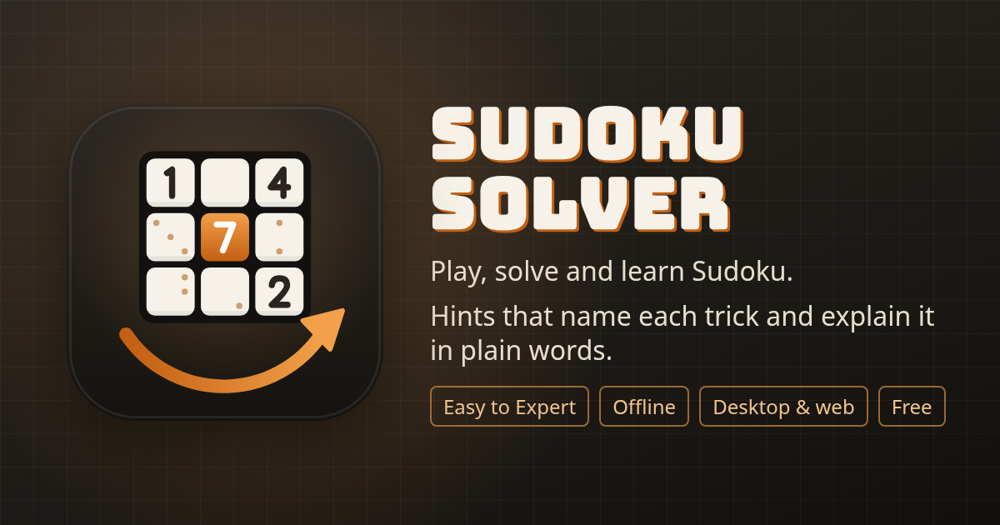</p>

<h1 align="center">Sudoku Solver</h1>

<p align="center">
  Play, generate or type in any 9x9 Sudoku. Solve it instantly, or get hints that<br />
  name the trick a person would use next, outline the squares involved and explain it in plain words.<br />
  Watch the whole puzzle solved step by step, forwards or backwards, at your own speed.
</p>

<p align="center">
  <a href="https://github.com/ccharafeddine/sudoku-solver/actions/workflows/ci.yml"></a>
  <a href="https://github.com/ccharafeddine/sudoku-solver/releases/latest"></a>
  <a href="LICENSE"></a>
</p>
<p align="center">
  
  
  
  
</p>

<p align="center">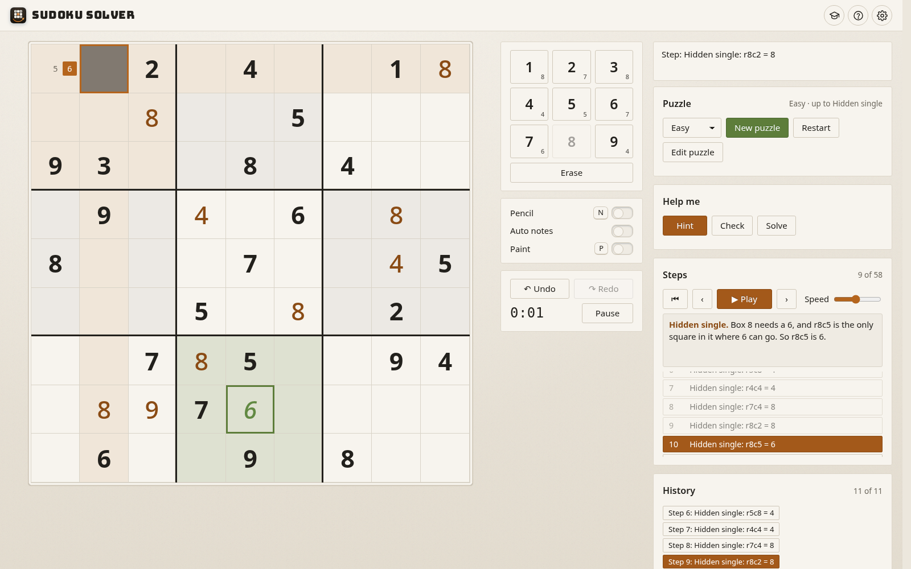</p>

<p align="center">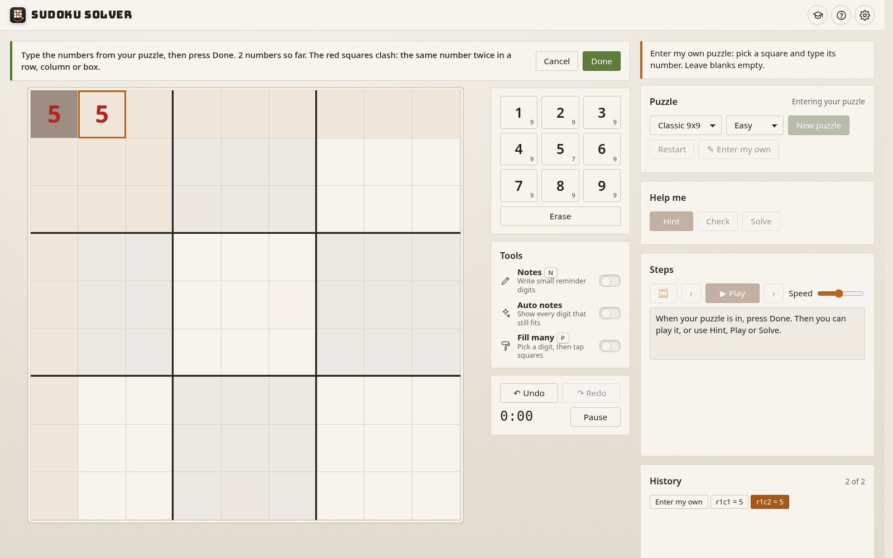</p>

<p align="center">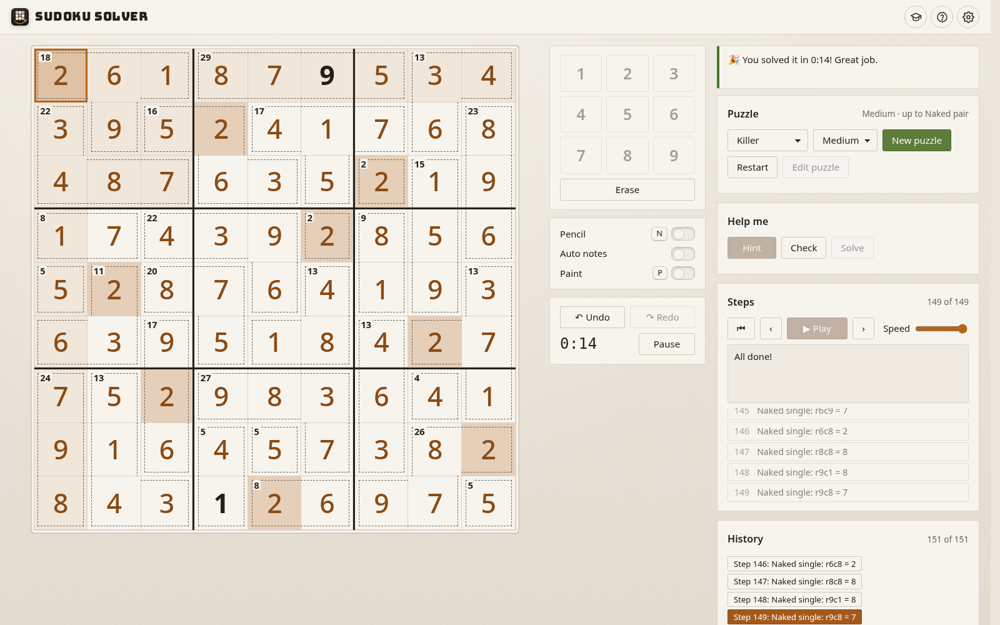 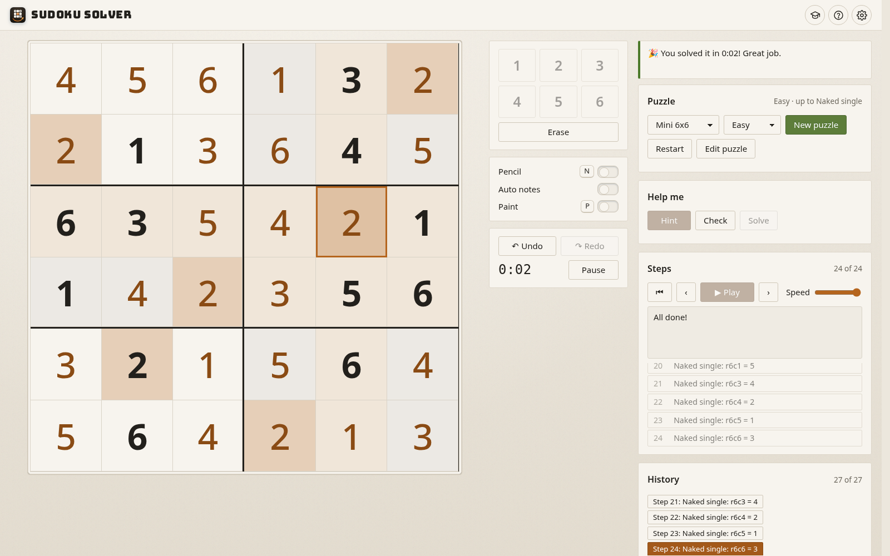</p>
<p align="center">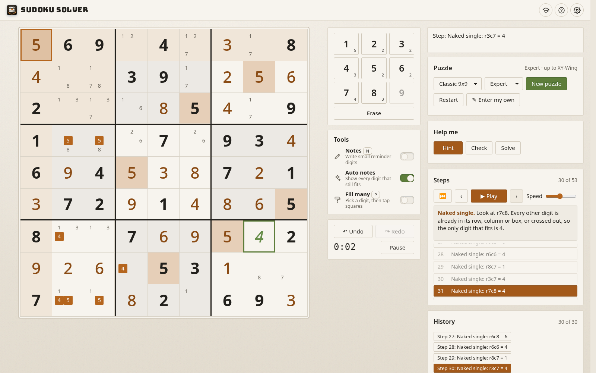</p>

<table align="center"><tr>
  <td width="33%">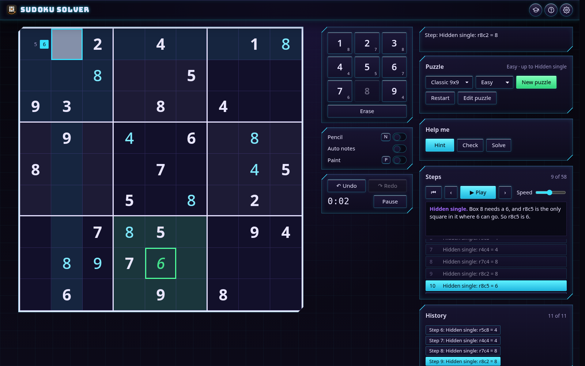<p align="center"><sub>Neon, dark</sub></p></td>
  <td width="33%">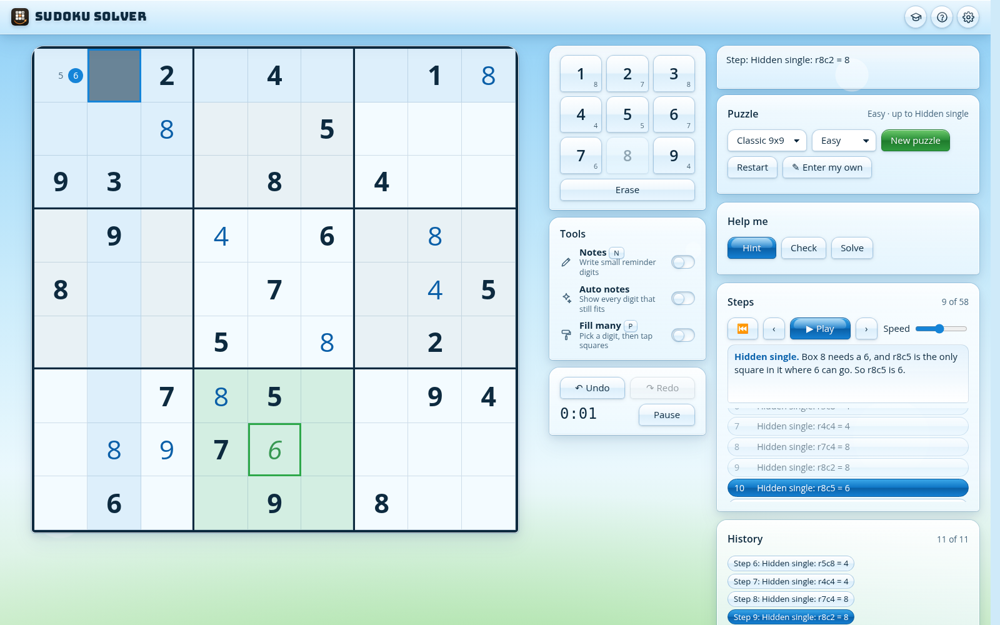<p align="center"><sub>Frutiger Aero, light</sub></p></td>
  <td width="33%">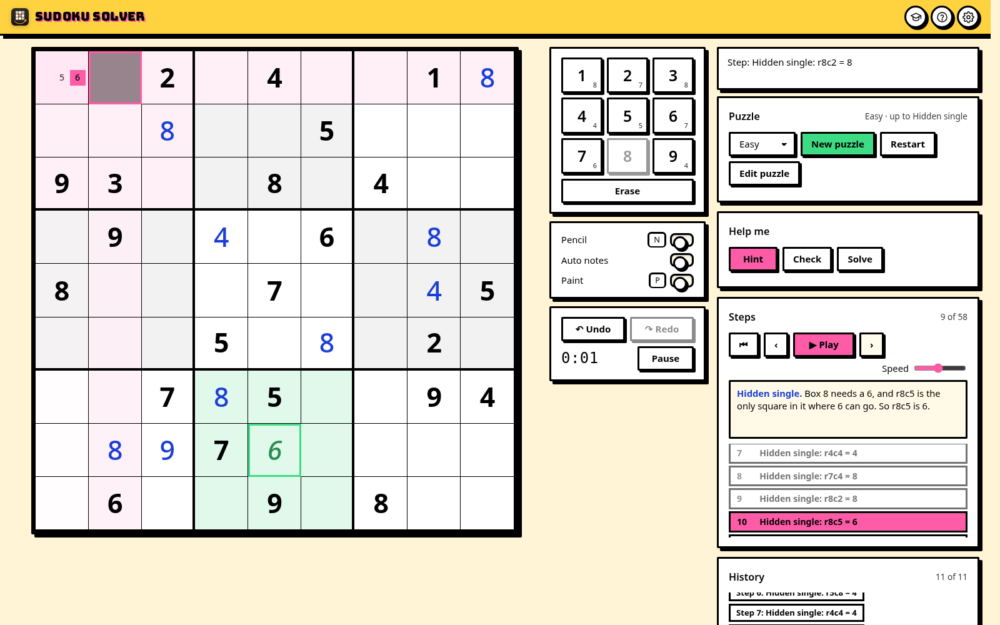<p align="center"><sub>Neubrutalism, light</sub></p></td>
</tr></table>

<table align="center"><tr>
  <td width="40%">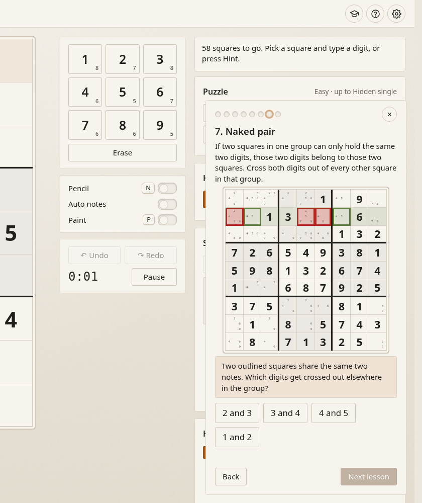<p align="center"><sub>Lessons: rules and tricks, each with a question</sub></p></td>
  <td width="40%">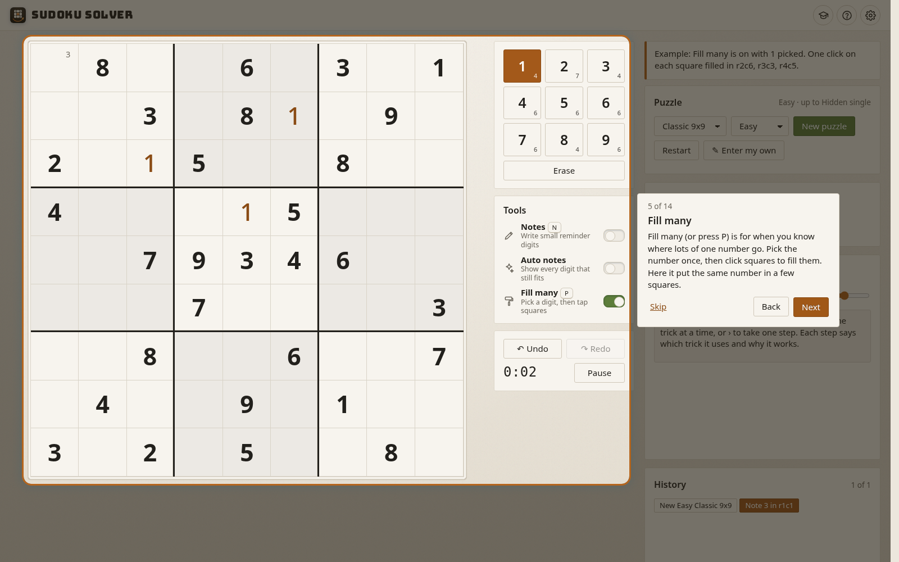<p align="center"><sub>A tour with live examples on the board</sub></p></td>
  <td width="20%">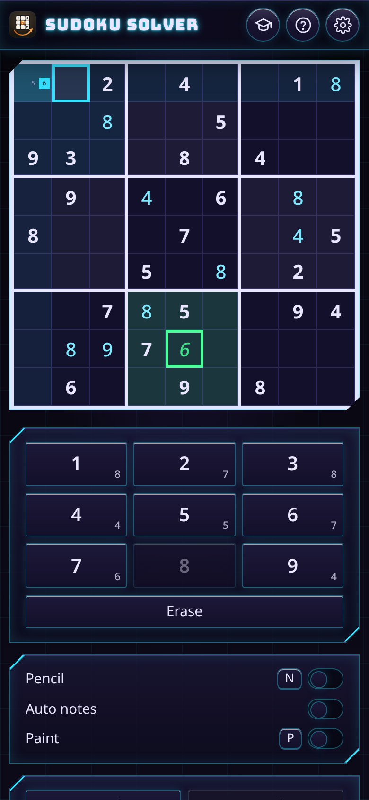<p align="center"><sub>Phones and touch</sub></p></td>
</tr></table>

## Features

**Playing**
- **Five puzzle shapes**: Classic 9x9, **Diagonal** (both long diagonals also hold 1 to 9 once), **Killer** (dashed cages with a sum in the corner; the digits in a cage add up to it and never repeat), and **Mini 6x6** and **Mini 4x4** for younger players. Pick one in the Puzzle card.
- A grid that scales to the window and stays square. Click a square (or move with the arrow keys), then type a digit, use the number pad, or click the **digit buttons**. Each button shows how many of that digit are still missing.
- **Given digits** (the puzzle) are bold and locked; your digits are coloured and can be changed.
- The everyday controls stay in view: the number buttons, **Erase**, **Undo**, **Hint**, **Check** and **Solve**. The extras sit in a **Tools** card, each with an icon, a one-line explanation and a tooltip:
  - **Notes** (<kbd>N</kbd>, or <kbd>Shift</kbd>+digit): write small reminder digits instead of answers.
  - **Auto notes**: show every digit that still fits in each empty square, kept up to date; you can still cross notes out by hand. Placing a digit removes the notes it rules out (can be switched off in Settings).
  - **Fill many** (<kbd>P</kbd>): pick a digit once, then click squares to fill them fast (or write it as a note with Notes on).
- **Conflict highlighting**: a digit that repeats in a row, column, box (or diagonal), or a full cage with the wrong sum, turns red straight away.
- **Show mistakes** (Settings, on by default): a digit that doesn't match the answer is marked at once. If the puzzle has no answer or more than one, only clashes are marked.
- **Guides**: the picked square's row, column and box are lightly shaded, and every square with the same digit (and that digit in notes) lights up. Can be switched off in Settings.
- **Undo/redo** and a **History timeline**: every action is listed; click any entry to jump there, backwards or forwards.
- A **timer** that counts only while you play: it pauses when the tab is hidden or with **Pause** (which also hides the grid), and stops when you finish.
- Your game, notes, history position and time are saved in the browser and resumed next time.

**Puzzles**
- **New puzzle** at Easy, Medium, Hard, Expert or **Fiendish** (Classic and Diagonal have all five; Killer has Medium and Hard; Mini 6x6 has Easy and Medium; Mini 4x4 has Easy). Every puzzle has exactly one answer, and its level is the hardest trick the human-style solver needed (see below), not a clue count. Puzzles are symmetric, like printed ones.
- **✎ Enter my own** types in a puzzle from a book or newspaper (Classic, Diagonal, 6x6 or 4x4). It asks first if that would wipe your game, then clears the board in the chosen shape and shows a bar: *Type the numbers from your puzzle, then press Done.* The bar counts your numbers and clashing squares turn red as you type. **Done** checks there are enough numbers and exactly one answer (and says plainly if there is none or more than one); then the numbers lock in, the puzzle is rated, and Hint, Check, Solve and Play all work. **Cancel** goes back to the puzzle you had. Killer can't be typed in, because drawing cages by hand would need a separate cage editor; Killer puzzles can still be loaded from a share link.
- **Load and share**: paste 81 digits (0 or `.` for blanks; spaces, line breaks and `|` `+` `-` grid lines are ignored), a pretty-printed grid, or a share link. **Copy puzzle** gives the 81-character string, **Copy as grid** a readable 9x9 block, and **Copy share link** a URL with the puzzle and your progress (`#p=<81 givens>&e=<81 entered>`).

**Help when you want it**
- **Hint** shows the next step a person would take. It names the trick, outlines the squares that make the pattern, shades the rows, columns or boxes it is about, shows the digit to write (as a ghost digit) or the notes it crosses out (in red), and explains why in plain words. Press it again (**Do it**) to make the step. If one of your digits is wrong, the hint says so first.
- **Check** compares your digits with the answer and marks wrong ones for a few seconds.
- **Solve** fills in the answer at once.
- **Steps**: **▶ Play** works out every remaining step the human way and plays them one at a time, with the **Speed** slider setting the pace (read every step, so moving it mid-play works). **‹** / **›** step back and forward, **⏮** goes back to the first step, and clicking any step in the list jumps there. Steps are ordinary history entries, so undo and the History timeline walk them too.
- Plain-words status messages for puzzles with **no solution** (and why: a clash, a square with no digit left, or a dead end) or **more than one solution**.

**App**
- Runs in the **browser**, installs as an offline **PWA**, and installs on **Windows** as a small desktop app (Tauri 2).
- **Four themes** (Matte by default, Frutiger Aero, Neon, Neubrutalism), each light and dark, with **System** (follow the computer, live) as the default mode. All in **Settings** (⚙), with play options, the update check (desktop app only) and About.
- An interactive **tutorial** (rules and tricks) and an app **tour**, a shortcut sheet, and an error banner with Reload.
- A wide layout whose controls stay put: fixed panel heights, inner scrolling, pinned playback controls and a reserved scrollbar gutter, so nothing shifts as hints, steps and history change. It folds to one column on phones and tablets.
- All searching runs in a **Web Worker**, so the page never stalls.

**Why no 16x16 or Jigsaw?** 16x16 needs letters as digits, a 16-button pad, and generating and checking a unique 16x16 puzzle in the browser is much slower. Jigsaw needs an editor for odd-shaped regions, and random regions often can't be filled at all. Both were left out to keep the app fast and simple.

## Download

Prebuilt binaries are on the [releases page](https://github.com/ccharafeddine/sudoku-solver/releases/latest) once a version is tagged:

- **Windows installer:** `Sudoku.Solver_<version>_x64-setup.exe`, a per-user install (no admin rights) with Start Menu and desktop shortcuts and an uninstall entry.
- **Windows MSI:** `Sudoku.Solver_<version>_x64_en-US.msi`, for managed installs.
- **Web bundle:** `sudoku-solver-web-<version>.zip`, a static site you can host anywhere.

The binaries are unsigned, so SmartScreen may warn on first run: choose **More info → Run anyway**. The desktop app needs WebView2, which ships with Windows 10 and 11.

## Quick start

Requirements: Node.js 20.19+ and npm.

```bash
npm install
npm run dev        # http://localhost:5175 (set PORT to change it)
```

| Script | What it does |
|---|---|
| `npm run dev` | Dev server with hot reload |
| `npm test` | Vitest unit tests |
| `npm run lint` | ESLint |
| `npm run build` | Type-check, then build the web app into `dist/` |
| `npm run preview` | Serve the production build |
| `npm run desktop` | Build the Windows installers (needs Rust; see `lessons.md`) |
| `npm run desktop:dev` | Run the desktop app against the dev server |

### Hosting the web build

`dist/` is a static site with relative paths, so it works from any folder or subdomain. `wrangler.jsonc` deploys it as a Cloudflare Worker with static assets (`npm ci && npm run build`, then `npx wrangler deploy`); the domain is attached in the Cloudflare dashboard, not in the repo. Set `SITE_URL` at build time (for example `SITE_URL=https://example.com npm run build`) to make the link-preview image and URL absolute; without it they stay relative and everything else works the same.

## Tutorial

The first time you open the app, a welcome card offers **Learn Sudoku**, **Tour the app** or **Not now**. The 🎓 button opens the Tutorial menu at any time, with your progress (for example `5/8 lessons · tour done`), resume, start over and reset. The offer is not shown when the app is opened from a share link.

**Lessons.** Each lesson has its own small board inside the coach card, so your puzzle is never touched. Every answer is checked by a unit test.

| # | Lesson | You do |
|---|---|---|
| 1 | The rule: rows | Pick the digit missing from a row |
| 2 | The rule: columns and boxes | Pick the digit missing from a box |
| 3 | Naked single | Combine a square's row, column and box to find its only digit |
| 4 | Hidden single | Click the only square in a box where a 1 can go |
| 5 | Pencil marks | Work out which digit could still go in a square |
| 6 | Pointing | On a real puzzle with notes, say which digit gets crossed out |
| 7 | Naked pair | Say which two digits get crossed out |
| 8 | X-Wing | Say which digit the rectangle rules out |

Lessons 6 to 8 use the first real example of that trick found in the bundled puzzles, with the pattern outlined and the squares that lose a note marked, and explain it after you answer.

**App tour.** A spotlight steps through fourteen parts of the app. The steps for **Notes**, **Auto notes**, **Fill many**, **Show mistakes**, **Enter my own**, **Hint** and **Steps** each play a small live example on your board (notes appear in a square, auto notes fill in, a few squares get filled, a wrong number turns red, the Done bar appears, a hint is outlined, the first steps play out), and your board, tools and timer are put back exactly when you move on or close the tour. The examples never touch History or your saved game. Clicks inside the spotlight reach the real control; ← → move, <kbd>Esc</kbd> or clicking the dimmed area closes it. The card parks beside large targets and above or below small ones, always on screen, and docks to the bottom on phones. Touch screens get "tap" wording.

## Controls and shortcuts

| Control | What it does |
|---|---|
| Click a square, or <kbd>↑</kbd> <kbd>↓</kbd> <kbd>←</kbd> <kbd>→</kbd> | Pick a square (arrows wrap around the edges) |
| <kbd>1</kbd>–<kbd>9</kbd>, number pad, or the digit buttons | Write a digit (typing the same digit again erases it); with Notes on, write a note |
| <kbd>Shift</kbd>+<kbd>1</kbd>–<kbd>9</kbd> | Write a note, even with Notes off |
| <kbd>Delete</kbd>, <kbd>Backspace</kbd>, <kbd>0</kbd>, or **Erase** | Erase the square (or its notes) |
| <kbd>N</kbd> / **Notes** | Notes on or off |
| **Auto notes** | Show every digit that still fits, kept up to date |
| <kbd>P</kbd> / **Fill many** | Pick a digit, then click squares to fill them |
| <kbd>Ctrl</kbd>+<kbd>Z</kbd> / <kbd>Ctrl</kbd>+<kbd>Y</kbd> (or <kbd>Ctrl</kbd>+<kbd>Shift</kbd>+<kbd>Z</kbd>) | Undo / redo |
| **History** entries | Jump to any point, either direction |
| <kbd>H</kbd> / **Hint** | Show the next step; press again to do it |
| <kbd>C</kbd> / **Check** | Mark wrong digits |
| **Solve** | Fill in the answer |
| <kbd>Space</kbd> / **▶ Play** | Play or pause the steps |
| <kbd>[</kbd> / <kbd>]</kbd>, **‹** / **›**, **⏮** | Step back / forward / to the first step |
| **Speed** slider | Step playback pace (about 2.2 s down to under 0.1 s a step) |
| <kbd>Alt</kbd>+<kbd>N</kbd> / **New puzzle** | New puzzle at the chosen level |
| <kbd>Alt</kbd>+<kbd>E</kbd> / **✎ Enter my own** | Type in a puzzle from a book or newspaper |
| **Restart** | Clear your digits and notes |
| **Pause** | Stop the clock and hide the grid |
| <kbd>Esc</kbd> | Close a hint, stop Fill many, or unpick the square; closes lessons and dialogs |
| <kbd>?</kbd> | Shortcut sheet |
| 🎓 / ⚙ | Tutorial menu / Settings |

## How it works

### The instant solver

`src/sudoku/solver.ts` is a depth-first search over bitmasks: each row, column and box keeps a 9-bit mask of the digits it already has, so the digits that fit a square are one OR and one NOT away. It always branches on the empty square with the fewest options (a square with one option is filled at once; one with none ends the branch). It counts solutions up to a limit of 2, which is how it tells **unique**, **multiple** (and returns two different answers) and **none** apart; obvious "none" cases (a clash, a square with no digit left) are named before searching. Any valid puzzle takes well under a millisecond; the famously hard "Arto Inkala" puzzle is a test case.

### The human-style solver

`src/sudoku/logic.ts` keeps pencil marks and looks for one pattern at a time, easiest first, exactly like a person:

| Level | Technique | The idea |
|---|---|---|
| Easy | Naked single | Only one digit fits a square |
| Easy | Hidden single | A digit has only one place left in a row, column or box |
| Medium | Pointing | In a box, a digit is stuck in one row or column, so the rest of that line can't have it |
| Medium | Box-line | In a row or column, a digit is stuck in one box, so the rest of that box can't have it |
| Medium | Naked pair | Two squares share the same two digits |
| Medium | Hidden pair | Two digits share the same two squares |
| Hard | Naked triple / Hidden triple | The same with three |
| Hard | X-Wing | A digit's spots in two rows line up in two columns |
| Expert | XY-Wing | Three two-digit squares that force a digit into one of two places |
| Expert | Swordfish | The X-Wing with three rows and columns |
| Fiendish | Jellyfish | The X-Wing with four rows and columns |
| Fiendish | XYZ-Wing | Like the XY-Wing, but the middle square has three digits |
| Fiendish | W-Wing | Two matching two-digit squares tied by a strong link |
| Fiendish | Simple colouring | Follow one digit's either-or links in two colours; a clash or a square seeing both colours rules it out |
| Fiendish | Unique rectangle | Four squares that would allow two answers, so one digit must go (Classic only) |
| Medium (Killer) | Cage sum | Only some digits can add up to a cage's sum |

Every step records its technique, the pattern squares, the groups involved, the digits, the placement or eliminations, and a plain-words explanation built from the actual squares (`r3c5` means row 3, column 5). Tests replay every step of 170 puzzles against the true answer: a placement must match it and an elimination must never remove it, and every technique must turn up.

**Difficulty** is the level of the hardest technique the puzzle needs. A puzzle that these techniques can't finish is shown as **Beyond Fiendish: needs guessing** (it can be typed in or loaded, but the generator never makes one).

### The generator

`src/sudoku/generator.ts` fills a random grid, then removes digits in mirror-image pairs, keeping a removal only while the puzzle still has exactly one solution and is no harder than the level asked for. The result is kept if its rating matches. On this machine one attempt takes about 3 ms; Easy and Medium come almost at once and Expert usually within a few hundred milliseconds. Diagonal, Killer and Mini puzzles use the same search with their extra rules (Killer first cuts the answer into cages of 2 to 4 touching squares). If the time budget (1.5 s, 3 s for Killer) runs out, it takes a bundled puzzle of that level (`src/sudoku/seeds.ts`, all re-rated by the tests) and disguises it: relabelled digits, shuffled rows within bands, bands, columns within stacks, stacks, and maybe a flip. None of those changes the techniques a puzzle needs.

### Layout

```
src/
  sudoku/board.ts       grid model, units and peers, parsing, conflicts, candidates
  sudoku/solver.ts      instant bitmask solver, uniqueness, random full grids
  sudoku/logic.ts       human-style techniques, step explanations, rating
  sudoku/generator.ts   puzzles by difficulty; seeded PRNG; symmetry disguise
  sudoku/seeds.ts       rated fallback puzzles
  sudoku/worker.ts      Web Worker running the above; protocol.ts types its messages
  app/history.ts        two-way snapshot timeline (undo, redo, jump)
  app/share.ts          share links and import
  app/timer.ts          play timer and playback pacing
  app/update.ts         desktop-only GitHub release check
  ui/board.ts           draws a board (main grid and lesson boards)
  tutorial/             lessons, the coach card, the spotlight tour
  theme/                tokens.css (4 skins x light/dark) and skin selection
  build/siteMeta.ts     SITE_URL link-preview rewrite (Vite plugin)
  main.ts               wiring
src-tauri/              desktop shell (Tauri 2)
brand/                  logo source, social card source, asset inventory
```

## Testing

`npm test` runs Vitest in Node. The suites cover the board model, the instant solver (unique, multiple, none, clashes, dead squares, hard puzzles), every logical technique's soundness on 170 puzzles, the rating and generator at every level (including the seed fallback and disguise), history jumps, share links, the timer, every lesson's answer, tour geometry and its live examples, the Enter my own checks, theme tokens (every skin defines every token; select and text contrast is WCAG AA in all eight variants), branding, and the no-shift layout rules. CI runs lint, tests and the build on every push.

## Releasing

Bump the version in `package.json`, `src-tauri/tauri.conf.json` and `src-tauri/Cargo.toml`, add `docs/release-notes/v<version>.md`, then push a `v<version>` tag. The release workflow creates the GitHub release, uploads the web bundle, and builds the Windows installers.

## License

MIT, see [LICENSE](LICENSE). The Bungee title font is under the SIL Open Font License (`src/assets/fonts/Bungee-OFL.txt`).
